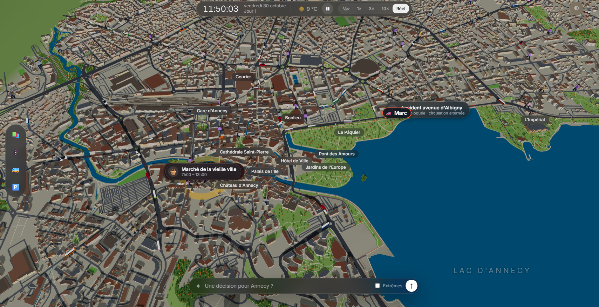

# Ane-sims 🏔️

**Une ville, des milliers d’habitants et des décisions qui changent leur quotidien.**

Annecy en 3D, avec ses rues, son lac, ses transports et ses habitants. Observez la ville vivre, déclenchez des événements en langage naturel et discutez avec les personnes suivies par l’IA.



## Dans la ville

- 🏘️ **2 550 habitants** par défaut : 50 suivis par IA et 2 500 aux comportements automatiques.
- 💬 **Des conversations individuelles**, avec un contexte et des souvenirs propres à chaque habitant IA pendant la session.
- 🚗 **Une ville en mouvement** : piétons, vélos, voitures, bus et stationnement. Retrouvez aussi Marc dans son bouchon avenue d’Albigny.
- 🎪 **Des événements à inventer** : proposez une décision, observez les réactions et consultez ses effets sur la ville.
- 📊 **Une page `/stats`** pour suivre les appels au modèle, les erreurs et régler la configuration IA.

## Lancer en local

Prérequis : **Node.js 20+**, npm et une clé [Arkane Cloud](https://console.arkanecloud.com) pour les fonctions IA.

```powershell
npm ci
Copy-Item .env.example .env
```

Renseignez `ARKANE_API_KEY` dans `.env`, puis démarrez :

```powershell
npm run dev
```

Ouvrez l’adresse indiquée par Vite. Le modèle des habitants est **Qwen** (`qwen38-27b-turbo-v2`) par défaut, réglable dans `/stats`. Gardez votre fichier `.env` privé.

## Avec Docker

```powershell
docker build -t ane-sims .
docker run --rm -p 8080:8080 --env-file .env -v ane-sims-data:/app/data ane-sims
```

La ville est accessible sur **http://localhost:8080**. Le chart Kubernetes est dans [`helm/ane-sims`](helm/ane-sims).

## Sous le capot

**TypeScript · Three.js · Vite · Web Worker · Arkane · Docker · Helm**

La carte s’appuie sur les données [OpenStreetMap](https://www.openstreetmap.org/copyright). Le moteur de simulation tourne dans un Web Worker pour séparer la vie de la ville de son affichage.

```powershell
npm run build                   # Vérifier les types et compiler le site
npm run build:server            # Compiler le serveur de production
npm run test:ai                 # Vérifier l’intelligence et les conversations
npm run sim:headless -- 2550 1   # Simuler une journée sans affichage
```

## L’équipe

Créé pendant un hackathon, à trois :

| Nathan | Pierre | Alexis |
| :---: | :---: | :---: |
| [@EnterNAthan](https://github.com/EnterNAthan) | [@pierreRISS](https://github.com/pierreRISS) | [@alexis-cloud-algebra](https://github.com/alexis-cloud-algebra) |
